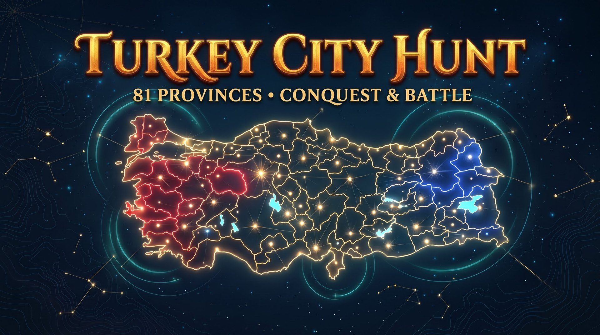

#  Turkey City Hunt — 81 Provinces • Conquest & Battle

### 🎮 [PLAY — Turkey City Hunt](https://zinetoytekin.github.io/gmt458_hw2/)




---

##  Overview

**Turkey City Hunt** is an interactive **Web GIS GeoGame** styled in a **Night Atlas** theme, covering all **81 provinces of Turkey** with clickable province borders, live geographic coordinates, geodesic distance/bearing feedback, and procedural Web Audio sound effects.

Play solo in a high-tempo 90-second rush to climb the leaderboard, or challenge a friend in a turn-based conquest where every captured province recruits troops for an animated **Grand Battle** finale.

---

##  Key Features

- **Full-Screen Interactive Title Screen:** Features the custom cover artwork with glassmorphic overlays for **Single Player Setup**, **Two-Player Battle Setup**, **How to Play**, and **Difficulty Selection**.
- **81 Provinces with Real Borders:** Clickable GeoJSON province polygons and city markers over a label-free **Esri World Dark Gray Base** map, with a one-click toggle to **Esri World Imagery** satellite view.
- **Live Coordinates:** Real-time **Latitude / Longitude** tracking as you move the cursor across the map.
- **Hot / Cold Thermal Map & Geodesic Azimuth:** Every wrong guess calculates real geodesic distance (`km`) and 8-way compass direction, dynamically painting the guessed province from 🔥 **red** (very close) to ❄️ **blue** (far away).
- **3 Strategic Jokers & Keyboard Shortcuts:**
  - `1` **Show Region:** Highlights all provinces in the target's geographical region along their real borders.
  - `2` **Extra Clue:** Unlocks an additional hint for the current province.
  - `3` **Eliminate Wrong:** Removes ~65% of incorrect provinces from the map.
  - `P` **Skip:** Skips the current province in Single Player mode (`-5 sec`, 2 skips per game).
- **Custom Colours & Turn Immersion:** Pick your own conquest colour in both 1P and 2P modes (with automatic contrast validation in 2P so commanders never pick overly similar colours). In 2P mode, the entire HUD and map tint shift dynamically on each turn.
- **Animated Grand Battle Finale:** A custom HTML5 Canvas battle simulation (`BattleFX`) where both commanders' recruited armies march, clash with sparks and dust, and celebrate victory with confetti.
- **Post-Game Analytics & Procedural Audio:** Interactive **Chart.js** bar charts and a **7-Region Accuracy Radar**, paired with a zero-dependency **Web Audio API** sound synthesizer.

---

## 🎮 Game Modes & Difficulty

###  Single Player (90s Rush)
- Identify as many provinces as possible in **90 seconds** with **3 lives**.
- **Streak Bonus:** 3 correct guesses in a row grant **+25 points & +5 seconds**.
- **Leaderboard:** Saves the Top 5 scores locally via `localStorage`.

### ⚔️ Two-Player Battle (10 Turns • Conquest)
- Two commanders alternate turns across **10 questions** (5 provinces each).
- Each turn gives **60 seconds** and up to **3 guesses**.
- Conquering a province paints it permanently in your army's colour and recruits **+100 troops** (`-20` per joker used, `+25` streak reinforcement).
- After Question 10, both armies clash in the **Grand Battle** — the larger army wins!

### Difficulty Levels
| Difficulty | Jokers | Clue Style | Single-Player Penalty |
| :--- | :---: | :--- | :--- |
| **🟢 Easy** | Unlimited (`∞`) | Clear clues | `-3 sec`, `-1 ❤️` every 3 misses |
| **🟡 Medium** | 3 per player | Trickier clues | `-5 sec`, `-1 ❤️` every 2 misses |
| **🔴 Hard** | 3 per player | Trickier clues | Direct `-1 ❤️` on every miss |

---

## 🛠️ Tech Stack & Open Data

- **Mapping & Spatial Logic:** [Leaflet.js v1.9.4](https://leafletjs.com/)
- **Data Visualization:** [Chart.js v4](https://www.chartjs.org/)
- **Graphics & Audio:** HTML5 Canvas (`fx.js`), Web Audio API (`soundFX`)
- **Typography:** Google Fonts (*Fraunces* & *Plus Jakarta Sans*)
- **Datasets:**
  - `data/turkey_cities.geojson` — 81 provinces with coordinates, plate codes, regions, and multi-tier clues.
  - Turkey province boundary GeoJSON (`tr-cities-utf8.json`).

---

## project Structure

```text
turkiye-sehir-avi-v3/
├── index.html                  # Main layout, title overlays, HUD & modals
├── style.css                   # Night Atlas theme, glassmorphic UI & turn tints
├── app.js                      # Game engine (closures), Leaflet map, jokers & charts
├── fx.js                       # Starfield background (HeroFX) & battle animation (BattleFX)
├── assets/
│   └── hero.jpg                # Full-screen cover artwork
├── data/
│   └── turkey_cities.geojson   # 81 provinces dataset
└── README.md                   # Project documentation
```

---

##  Running Locally

Because the game fetches `data/turkey_cities.geojson`, serve the project folder using any local static server:


Then open **`http://localhost:8000`** in your browser. *(An active internet connection is required for Esri map tiles, Leaflet, Chart.js, Google Fonts, and province borders.)*

---

##  Technical Architecture Notes

- **Encapsulation via Closures:** Both `createCityHuntEngine()` (managing 1P/2P scores, timers, lives, armies, jokers, and regional stats) and `soundFX` (managing the Web Audio context and mute state) keep all internal state private.
- **Event-Driven GIS Interaction:** Combines Leaflet `click` / `mouseover` / `mousemove` listeners on 81 province polygons and markers with keyboard shortcuts (`1`, `2`, `3`, `P`, `Esc`) and dynamic modal/HUD state transitions.
